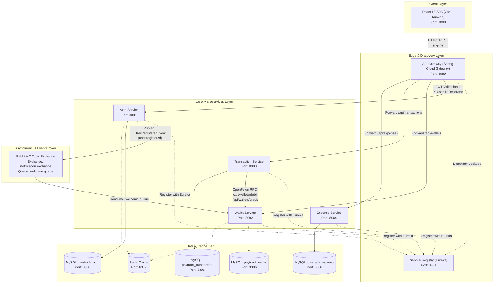
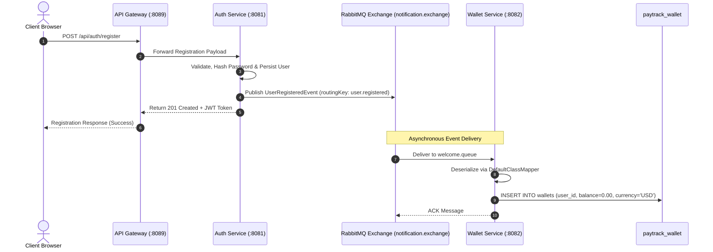
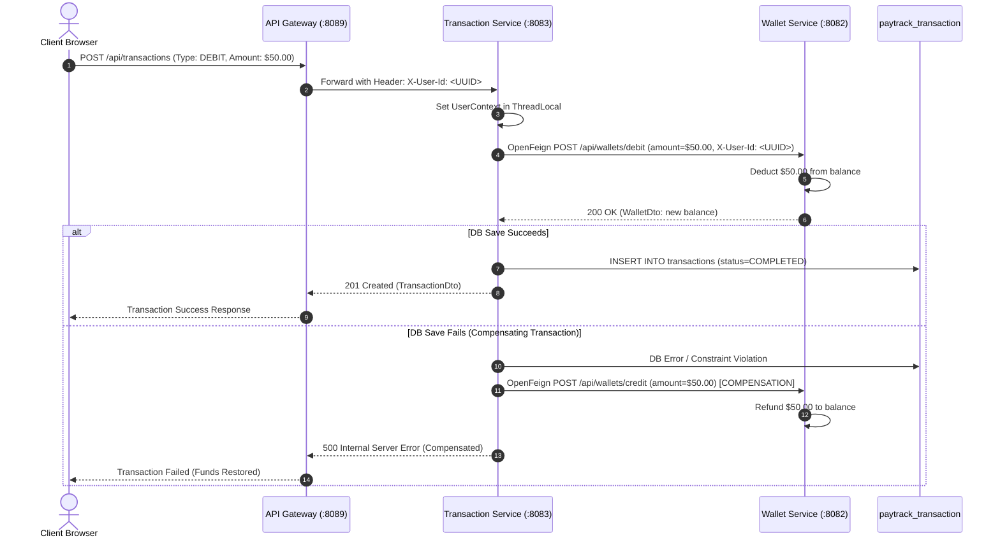

# PayTrack Digital Wallet System - Complete Application Implementation Document

**System Version:** 1.0.0  
**Repository:** [git@github.com:Varun-sai018/PayTrack.git](https://github.com/Varun-sai018/PayTrack)  
**Branches:** `main` | `develop`  
**Total Commits:** 35 Semantic Commits  
**Document Generated:** November 2026  

---

## Table of Contents

1. [Executive Summary](#1-executive-summary)
2. [High-Level Architecture](#2-high-level-architecture)
3. [Technology Stack](#3-technology-stack)
4. [Service Registry & Port Allocation](#4-service-registry--port-allocation)
5. [Microservices Deep-Dive](#5-microservices-deep-dive)
   - 5.1 [Eureka Service Discovery](#51-eureka-service-discovery-eureka-service)
   - 5.2 [API Gateway Service](#52-api-gateway-service-api-gateway-service)
   - 5.3 [Authentication Service](#53-authentication-service-auth-service)
   - 5.4 [Wallet Service](#54-wallet-service-wallet-service)
   - 5.5 [Transaction Service](#55-transaction-service-transaction-service)
   - 5.6 [Expense Service](#56-expense-service-expense-service)
6. [Frontend Single Page Application](#6-frontend-single-page-application-react--vite--tailwind)
   - 6.1 [Architecture & Design Tokens](#61-architecture--design-tokens)
   - 6.2 [Component & Page Hierarchy](#62-component--page-hierarchy)
   - 6.3 [API Proxy & Authentication Interceptors](#63-api-proxy--authentication-interceptors)
7. [Inter-Service Communication & Event Topology](#7-inter-service-communication--event-topology)
   - 7.1 [Asynchronous Messaging with RabbitMQ](#71-asynchronous-messaging-with-rabbitmq)
   - 7.2 [Synchronous Invocations via OpenFeign & Compensations](#72-synchronous-invocations-via-openfeign--compensations)
8. [Security & Identity Propagation](#8-security--identity-propagation)
9. [Database Persistence & Schemas](#9-database-persistence--schemas)
10. [Complete REST API Specification](#10-complete-rest-api-specification)
11. [Resolved Architectural Issues & Bug Fixes](#11-resolved-architectural-issues--bug-fixes)
    - 11.1 [Phase 1: 20 Foundational Architectural Fixes](#111-phase-1-20-foundational-architectural-fixes)
    - 11.2 [Phase 2: 5 Critical Runtime Fixes](#112-phase-2-5-critical-runtime-fixes)
    - 11.3 [Phase 3: 4 Frontend Integration Fixes](#113-phase-3-4-frontend-integration-fixes)
12. [Verification & End-to-End Test Evidence](#12-verification--end-to-end-test-evidence)
13. [Deployment, Run & Verification Guide](#13-deployment-run--verification-guide)
14. [Complete Git Commit Log (35 Commits)](#14-complete-git-commit-log-35-commits)

---

## 1. Executive Summary

**PayTrack** is an enterprise-grade digital wallet, financial transaction processing, and personal expense tracking platform engineered with a cloud-native microservices architecture. The system combines Spring Cloud, Spring Boot 3.5, RabbitMQ event streaming, Redis caching, and MySQL database-per-service isolation with an intuitive, dark-themed React 18 single-page application (SPA).

### Key Functional Capabilities
- **Decentralized Authentication & Security**: JWT-based identity tokens featuring secure claims (`userId`, `roles`, `email`), centralized API Gateway token validation, and downstream `X-User-Id` header context injection.
- **Event-Driven Wallet Provisioning**: Zero-latency user onboarding where registration emits an AMQP event that triggers asynchronous wallet provisioning in an isolated microservice.
- **Atomic Financial Transactions**: Full ledger support for DEBIT, CREDIT, and balance adjustments with Feign RPC calls and compensating transactions guaranteeing eventual data consistency.
- **Categorized Expense Management**: Real-time spending categorization across Food, Transport, Housing, Entertainment, Utilities, Healthcare, and Shopping with aggregations and budget summaries.
- **High Performance UI**: Modern client built with React 18, Vite 5, Tailwind CSS, Space Grotesk typography, and responsive touchpoints.

---

## 2. High-Level Architecture

The platform follows a decoupled, domain-driven microservices architecture where services communicate synchronously via REST/OpenFeign and asynchronously via RabbitMQ topic exchanges.



---

## 3. Technology Stack

| Layer | Component | Version / Description |
|---|---|---|
| **Frontend Framework** | React.js | 18.3.1 (Virtual DOM, Context API, Hooks) |
| **Frontend Tooling** | Vite | 5.4.1 (ESM Hot Module Replacement, Rollup Bundler) |
| **Styling & Design** | Tailwind CSS | 3.4.19 (PostCSS, Autoprefixer, Custom Theme) |
| **Routing** | React Router DOM | 6.22.0 (Nested routing, ProtectedRoute guards) |
| **HTTP Client** | Axios | 1.6.7 (Custom request/response interceptors) |
| **Backend Framework** | Spring Boot | 3.5.5 |
| **Cloud Infrastructure** | Spring Cloud | 2025.0.0 (Gateway, Eureka Client/Server, OpenFeign) |
| **Programming Language** | Java | 17 LTS / OpenJDK |
| **Build & Dependency Tool** | Apache Maven | 3.9.6 (Multi-module hierarchical parent POM) |
| **Security & Auth** | Spring Security | 6.x + Auth0 `java-jwt` (HMAC256 algorithm) |
| **Relational Databases** | MySQL | 8.0.x (Database-per-service isolation pattern) |
| **Database Migrations** | Flyway | Native automated schema migrations |
| **In-Memory Cache** | Redis | 7.x (Session management & distributed rate limiting) |
| **Message Broker** | RabbitMQ | 3.12+ (AMQP 0-9-1 Topic Exchange) |
| **Fault Tolerance** | Resilience4j | Circuit Breaker, Retry, Fallback controllers |

---

## 4. Service Registry & Port Allocation

| Component Name | Service ID in Eureka | Host / Runtime Port | Default Port | Description |
|---|---|---|---|---|
| **Eureka Server** | `EUREKA-SERVICE` | `8761` | `8761` | Service Registry & Health Tracker |
| **API Gateway** | `API-GATEWAY-SERVICE` | `8089` | `8080` | Reverse Proxy, JWT Validation, Header Decoration |
| **Auth Service** | `AUTH-SERVICE` | `8081` | `8081` | Authentication, JWT Issuance, User Lifecycle |
| **Wallet Service** | `WALLET-SERVICE` | `8082` | `8082` | Balance Management, Event-Driven Wallet Creation |
| **Transaction Service** | `TRANSACTION-SERVICE` | `8083` | `8083` | Transaction Processing, OpenFeign Debit/Credit |
| **Expense Service** | `EXPENSE-SERVICE` | `8084` | `8084` | Expense Tracking, Categorization & Summaries |
| **Frontend Client** | N/A | `3000` | `3000` | Vite Development & Production Client |
| **RabbitMQ Management** | N/A | `15672` (AMQP: `5672`) | `5672` | Asynchronous Messaging Broker |
| **Redis Cache** | N/A | `6379` | `6379` | Distributed Cache and Session Store |
| **MySQL Server** | N/A | `3306` | `3306` | Isolated Schemas: `paytrack_auth`, `paytrack_wallet`, etc. |

> [!NOTE]
> The API Gateway port is configured to `8089` in local development to prevent conflict with local enterprise services (such as Jenkins or system daemons that occupy `8080`).

---

## 5. Microservices Deep-Dive

### 5.1 Eureka Service Discovery (`eureka-service`)
- **Path:** [backend/eureka-service](file:///c:/Users/varun%20sai/st_school/PayTrack/backend/eureka-service)
- **Class:** `com.paytrack.eureka.EurekaServiceApplication`
- **Role:** High-availability service discovery directory using Netflix Eureka. All microservices automatically register on startup and send periodic heartbeats (30-second lease renewal).
- **Configuration Details:**
  - Eviction threshold: 85%
  - Self-preservation: Configured for fast local detection during development
  - Standalone mode: `registerWithEureka: false`, `fetchRegistry: false`

### 5.2 API Gateway Service (`api-gateway-service`)
- **Path:** [backend/api-gateway-service](file:///c:/Users/varun%20sai/st_school/PayTrack/backend/api-gateway-service)
- **Class:** `com.paytrack.gateway.ApiGatewayApplication`
- **Role:** Reactive Spring Cloud Gateway built on Project Reactor / WebFlux.
- **Core Responsibilities:**
  1. **Route Dispatching:**
     - `/api/auth/**` → `lb://AUTH-SERVICE`
     - `/api/wallets/**` → `lb://WALLET-SERVICE`
     - `/api/transactions/**` → `lb://TRANSACTION-SERVICE`
     - `/api/expenses/**` → `lb://EXPENSE-SERVICE`
  2. **Global Authentication WebFilter (`AuthenticationFilter.java`):**
     - Bypasses public endpoints (`/api/auth/register`, `/api/auth/login`, `/actuator/**`).
     - Extracts the `Authorization: Bearer <token>` header.
     - Verifies JWT integrity and expiration using HMAC256.
     - Reads the custom `userId` claim (UUID) and decorates the downstream request with:
       ```http
       X-User-Id: <UUID>
       ```
  3. **CORS Enforcement:** Allows origins `http://localhost:3000`, supporting credentials, headers (`Authorization`, `Content-Type`, `X-User-Id`), and methods (`GET`, `POST`, `PUT`, `DELETE`, `OPTIONS`).
  4. **Circuit Breakers:** Resilience4j integration reroutes failed microservices to `/fallback/auth`, `/fallback/wallet`, etc.

### 5.3 Authentication Service (`auth-service`)
- **Path:** [backend/auth-service](file:///c:/Users/varun%20sai/st_school/PayTrack/backend/auth-service)
- **Class:** `com.paytrack.auth.AuthServiceApplication`
- **Database Schema:** `paytrack_auth` (managed via Flyway migration `V1__init_schema.sql`).
- **Core Responsibilities:**
  1. **User Registration & Passwords:** Uses BCrypt (`cost factor 10`) for password hashing.
  2. **JWT Generation:** Emits signed JWT tokens with claims:
     ```json
     {
       "sub": "user@example.com",
       "userId": "e6a2187b-4889-4361-9c6a-4d743a510526",
       "role": "USER",
       "iss": "paytrack-auth",
       "exp": 1795368000
     }
     ```
  3. **Event Publishing:** On successful user registration, publishes a `UserRegisteredEvent` to RabbitMQ topic exchange `notification.exchange` with routing key `user.registered`.
  4. **User Context Security Filter (`UserContextFilter.java`):** Intercepts downstream `X-User-Id` header for protected endpoints like `GET /api/auth/me`, storing user context in `UserContextHolder` for thread-safe access without re-querying the database.

### 5.4 Wallet Service (`wallet-service`)
- **Path:** [backend/wallet-service](file:///c:/Users/varun%20sai/st_school/PayTrack/backend/wallet-service)
- **Class:** `com.paytrack.wallet.WalletServiceApplication`
- **Database Schema:** `paytrack_wallet`
- **Core Responsibilities:**
  1. **Asynchronous Wallet Creation:** Houses `@RabbitListener(queues = "welcome.queue")`. Upon receiving a `UserRegisteredEvent`, automatically initializes a new wallet for the user with an initial balance of `$0.00` and default currency `USD`.
  2. **Cross-Package AMQP Deserialization:** Utilizes `DefaultClassMapper` with explicit mapping for `com.paytrack.auth.event.UserRegisteredEvent` to prevent classpath conversion errors.
  3. **Balance Operations:**
     - `credit(userId, amount)`: Idempotently adds funds to the user's wallet.
     - `debit(userId, amount)`: Validates that balance >= amount; throws `InsufficientBalanceException` if balance is inadequate.
     - `getBalance(userId)`: Returns current balance and wallet status.

### 5.5 Transaction Service (`transaction-service`)
- **Path:** [backend/transaction-service](file:///c:/Users/varun%20sai/st_school/PayTrack/backend/transaction-service)
- **Class:** `com.paytrack.transaction.TransactionServiceApplication`
- **Database Schema:** `paytrack_transaction`
- **Core Responsibilities:**
  1. **Financial Ledger Record:** Records all operations with transaction type (`DEBIT`, `CREDIT`, `TRANSFER`), status (`PENDING`, `COMPLETED`, `FAILED`), amount, description, and timestamps.
  2. **Synchronous OpenFeign Client (`WalletClient.java`):** Communicates directly with `wallet-service` to execute balance adjustments.
  3. **Context Header Interceptor (`FeignClientInterceptor.java`):** Injects `X-User-Id` from `UserContextHolder` into outgoing Feign requests to ensure downstream wallet authorization.
  4. **Compensating Action Logic:** Solves non-atomic distributed transactions. If the transaction record persistence fails after a successful wallet debit, an automatic compensating credit is issued to refund the user's wallet.
  5. **Resilient Defaults:** When `walletId` is omitted in the client payload, defaults `walletId = userId` automatically.

### 5.6 Expense Service (`expense-service`)
- **Path:** [backend/expense-service](file:///c:/Users/varun%20sai/st_school/PayTrack/backend/expense-service)
- **Class:** `com.paytrack.expense.ExpenseServiceApplication`
- **Database Schema:** `paytrack_expense`
- **Core Responsibilities:**
  1. **Spending Categorization:** Categorizes expenditures across `FOOD`, `TRANSPORT`, `HOUSING`, `ENTERTAINMENT`, `UTILITIES`, `HEALTHCARE`, `SHOPPING`, `OTHER`.
  2. **Auto-Generated Identifiers:** Automatically generates unique UUIDs for `expenseId` if omitted by frontend clients.
  3. **Automatic Wallet Association:** Automatically defaults `walletId = userId` when not explicitly provided.
  4. **Aggregated Analytics:** Computes total expense counts, total amount spent, category-by-category breakdowns, and periodic monthly spending summaries.

---

## 6. Frontend Single Page Application (React + Vite + Tailwind)

### 6.1 Architecture & Design Tokens
- **Directory:** [frontend/](file:///c:/Users/varun%20sai/st_school/PayTrack/frontend)
- **Build System:** Vite 5 with Hot Module Replacement (HMR) and Rollup bundling.
- **CSS Architecture:** Tailwind CSS 3 with PostCSS and custom CSS design tokens defined in [styles/main.css](file:///c:/Users/varun%20sai/st_school/PayTrack/frontend/src/styles/main.css).
- **Design Tokens:**
  - Background Base: `#0A0F1A` (Deep Slate / Navy)
  - Card & Surface: `#111827` (Charcoal) with subtle border `#1F2937`
  - Brand Primary: `#06D6A0` (Electric Emerald / Cyan Accent)
  - Secondary Accent: `#3B82F6` (Electric Blue)
  - Typography: Space Grotesk (Headings & Metrics) + JetBrains Mono (Balances, IDs & Timestamps)

### 6.2 Component & Page Hierarchy

```
frontend/src/
├── main.jsx                     # ReactDOM root with AuthProvider & BrowserRouter
├── App.jsx                      # Route definitions (Public & Protected)
├── context/
│   └── AuthContext.jsx          # User state, token persistence, login/register/logout methods
├── services/
│   └── api.js                   # Centralized Axios instance with auth interceptors & proxy baseURL
├── components/
│   ├── auth/
│   │   └── ProtectedRoute.jsx   # Route guard: redirects unauthenticated requests to /login
│   ├── layout/
│   │   └── Header.jsx           # Responsive navigation header, user avatar, live wallet balance
│   └── ui/
│       ├── Button.jsx           # Primary, secondary, outline, danger, ghost variants with loading states
│       ├── Input.jsx            # Modern dark input fields with error and helper text
│       ├── Card.jsx             # Surface container with hover, borders, and padding options
│       └── Badge.jsx            # Status badges (success, danger, warning, info, default)
└── pages/
    ├── Login.jsx                # Authentication view with credentials validation
    ├── Register.jsx             # User registration view with password confirmation
    ├── Dashboard.jsx            # Portfolio metrics (Balance, Income, Expenses), recent activity, actions
    ├── Wallet.jsx               # Digital card view, balance display, Add Funds / Withdraw modals
    ├── Transactions.jsx         # Transaction history table with DEBIT/CREDIT filters and creation modal
    ├── Expenses.jsx             # Expense category cards, summaries, and Add Expense modal
    └── Settings.jsx             # Profile view, security credentials, preferences, and notifications
```

### 6.3 API Proxy & Authentication Interceptors

1. **Vite Reverse Proxy (`vite.config.js`):**
   ```javascript
   server: {
     port: 3000,
     proxy: {
       '/api': {
         target: 'http://localhost:8089',
         changeOrigin: true,
         secure: false
       }
     }
   }
   ```
   *Benefit:* Eliminates browser CORS issues during development and unifies all client requests to `/api/*`.

2. **Axios Interceptor (`services/api.js`):**
   - Automatically retrieves `token` from `localStorage`.
   - Injects `Authorization: Bearer <token>` into all outgoing HTTP headers.
   - Handles global `401 Unauthorized` responses by clearing local session state and redirecting the browser to `/login`.

---

## 7. Inter-Service Communication & Event Topology

### 7.1 Asynchronous Messaging with RabbitMQ

To guarantee decoupled and resilient user registration, the system uses an event-driven pattern for wallet creation:



#### Event Topology Configuration:
- **Exchange:** `notification.exchange` (Type: `topic`, Durable: `true`)
- **Queue:** `welcome.queue` (Durable: `true`)
- **Routing Key:** `user.registered`
- **Competing Consumer Resolution:** Only `wallet-service` binds to `welcome.queue`. The unused consumers in `transaction-service` and `expense-service` were removed to prevent round-robin message loss.
- **Cross-Package Mapping:**
  ```java
  DefaultClassMapper classMapper = new DefaultClassMapper();
  Map<String, Class<?>> idClassMapping = new HashMap<>();
  idClassMapping.put("com.paytrack.auth.event.UserRegisteredEvent", UserRegisteredEvent.class);
  classMapper.setIdClassMapping(idClassMapping);
  ```

### 7.2 Synchronous Invocations via OpenFeign & Compensations

For synchronous ledger transactions (such as debiting a user's wallet when recording an expense or transaction), `transaction-service` invokes `wallet-service` via Spring Cloud OpenFeign:



---

## 8. Security & Identity Propagation

The security model eliminates database authentication bottlenecks by relying on cryptographically signed tokens and edge-decorated user contexts:

```
[Client] 
   │  Sends "Authorization: Bearer <JWT>"
   ▼
[API Gateway]
   │  1. Verifies HMAC256 signature using shared secret
   │  2. Checks expiration timestamp (`exp`)
   │  3. Extracts custom claim `userId` (UUID)
   │  4. Injects HTTP header: "X-User-Id: <UUID>"
   ▼
[Downstream Microservice (Auth/Wallet/Transaction/Expense)]
   │  1. `UserContextFilter` extracts "X-User-Id" header
   │  2. Populates `UserContextHolder.setUserId(userId)`
   │  3. Business logic accesses user ID in O(1) time
   │  4. `UserContextFilter` clears ThreadLocal in `finally` block
```

---

## 9. Database Persistence & Schemas

Each microservice possesses complete schema ownership in accordance with the Microservice Database-per-Service pattern.

### 9.1 `paytrack_auth` (Auth Service)
```sql
CREATE TABLE users (
    id VARCHAR(36) PRIMARY KEY,
    email VARCHAR(255) NOT NULL UNIQUE,
    password VARCHAR(255) NOT NULL,
    first_name VARCHAR(100),
    last_name VARCHAR(100),
    role VARCHAR(50) DEFAULT 'USER',
    created_at TIMESTAMP DEFAULT CURRENT_TIMESTAMP,
    updated_at TIMESTAMP DEFAULT CURRENT_TIMESTAMP ON UPDATE CURRENT_TIMESTAMP
);
```

### 9.2 `paytrack_wallet` (Wallet Service)
```sql
CREATE TABLE wallets (
    id VARCHAR(36) PRIMARY KEY,
    user_id VARCHAR(36) NOT NULL UNIQUE,
    balance DECIMAL(15, 2) NOT NULL DEFAULT 0.00,
    currency VARCHAR(3) NOT NULL DEFAULT 'USD',
    status VARCHAR(50) DEFAULT 'ACTIVE',
    created_at TIMESTAMP DEFAULT CURRENT_TIMESTAMP,
    updated_at TIMESTAMP DEFAULT CURRENT_TIMESTAMP ON UPDATE CURRENT_TIMESTAMP,
    INDEX idx_wallets_user_id (user_id)
);
```

### 9.3 `paytrack_transaction` (Transaction Service)
```sql
CREATE TABLE transactions (
    id VARCHAR(36) PRIMARY KEY,
    user_id VARCHAR(36) NOT NULL,
    wallet_id VARCHAR(36) NOT NULL,
    type VARCHAR(50) NOT NULL, -- 'DEBIT', 'CREDIT', 'TRANSFER'
    amount DECIMAL(15, 2) NOT NULL,
    currency VARCHAR(3) NOT NULL DEFAULT 'USD',
    description VARCHAR(255),
    status VARCHAR(50) NOT NULL, -- 'PENDING', 'COMPLETED', 'FAILED'
    created_at TIMESTAMP DEFAULT CURRENT_TIMESTAMP,
    updated_at TIMESTAMP DEFAULT CURRENT_TIMESTAMP ON UPDATE CURRENT_TIMESTAMP,
    INDEX idx_transactions_user_id (user_id)
);
```

### 9.4 `paytrack_expense` (Expense Service)
```sql
CREATE TABLE expenses (
    id VARCHAR(36) PRIMARY KEY,
    user_id VARCHAR(36) NOT NULL,
    wallet_id VARCHAR(36) NOT NULL,
    category VARCHAR(50) NOT NULL, -- 'FOOD', 'TRANSPORT', 'HOUSING', etc.
    amount DECIMAL(15, 2) NOT NULL,
    currency VARCHAR(3) NOT NULL DEFAULT 'USD',
    description VARCHAR(255),
    date DATE NOT NULL,
    status VARCHAR(50) DEFAULT 'RECORDED',
    created_at TIMESTAMP DEFAULT CURRENT_TIMESTAMP,
    updated_at TIMESTAMP DEFAULT CURRENT_TIMESTAMP ON UPDATE CURRENT_TIMESTAMP,
    INDEX idx_expenses_user_id (user_id),
    INDEX idx_expenses_category (category)
);
```

---

## 10. Complete REST API Specification

### 10.1 Authentication Endpoints (`/api/auth`)
| Method | Endpoint | Auth | Headers | Request Body | Response (200/201) |
|---|---|---|---|---|---|
| `POST` | `/api/auth/register` | None | None | `{"email": "...", "password": "...", "firstName": "...", "lastName": "..."}` | `ApiResponse<AuthResponse>` (Token + User) |
| `POST` | `/api/auth/login` | None | None | `{"email": "...", "password": "..."}` | `ApiResponse<AuthResponse>` (Token + User) |
| `GET` | `/api/auth/me` | JWT | `Authorization: Bearer <token>` | None | `ApiResponse<UserDto>` |

### 10.2 Wallet Endpoints (`/api/wallets`)
| Method | Endpoint | Auth | Headers | Request Body | Response (200/201) |
|---|---|---|---|---|---|
| `GET` | `/api/wallets/me` | JWT | `Authorization: Bearer <token>` | None | `ApiResponse<WalletDto>` (Balance, Currency) |
| `POST` | `/api/wallets/credit` | JWT | `Authorization: Bearer <token>` | `{"amount": 100.00}` | `ApiResponse<WalletDto>` (New Balance) |
| `POST` | `/api/wallets/debit` | JWT | `Authorization: Bearer <token>` | `{"amount": 50.00}` | `ApiResponse<WalletDto>` (New Balance) |
| `GET` | `/api/wallets/{id}/balance` | JWT | `Authorization: Bearer <token>` | None | `ApiResponse<BigDecimal>` |

### 10.3 Transaction Endpoints (`/api/transactions`)
| Method | Endpoint | Auth | Headers | Request Body | Response (200/201) |
|---|---|---|---|---|---|
| `GET` | `/api/transactions` | JWT | `Authorization: Bearer <token>` | Query: `?page=0&size=20` | `ApiResponse<Page<TransactionDto>>` |
| `POST` | `/api/transactions` | JWT | `Authorization: Bearer <token>` | `{"amount": 50.00, "type": "DEBIT", "description": "Coffee"}` | `ApiResponse<TransactionDto>` |
| `GET` | `/api/transactions/{id}` | JWT | `Authorization: Bearer <token>` | None | `ApiResponse<TransactionDto>` |

### 10.4 Expense Endpoints (`/api/expenses`)
| Method | Endpoint | Auth | Headers | Request Body | Response (200/201) |
|---|---|---|---|---|---|
| `GET` | `/api/expenses` | JWT | `Authorization: Bearer <token>` | Query: `?page=0&size=20` | `ApiResponse<Page<ExpenseDto>>` |
| `POST` | `/api/expenses` | JWT | `Authorization: Bearer <token>` | `{"amount": 30.00, "category": "FOOD", "description": "Lunch", "date": "2026-11-22"}` | `ApiResponse<ExpenseDto>` |
| `GET` | `/api/expenses/summary` | JWT | `Authorization: Bearer <token>` | None | `ApiResponse<ExpenseSummaryDto>` |
| `DELETE` | `/api/expenses/{id}` | JWT | `Authorization: Bearer <token>` | None | `ApiResponse<Void>` |

---

## 11. Resolved Architectural Issues & Bug Fixes

A total of **29 critical engineering challenges** were diagnosed and systematically resolved across the backend and frontend.

### 11.1 Phase 1: 20 Foundational Architectural Fixes

| # | Component | Problem | Root Cause | Implemented Solution |
|---|---|---|---|---|
| **1** | Build | Multi-module Maven inheritance | Missing child module references | Added all 6 microservices to root parent `pom.xml`. |
| **2** | Eureka | Service heartbeat timeouts | Stale lease timers | Configured eviction intervals and self-preservation parameters. |
| **3** | Gateway | Route registration failure | Inverted predicate rules | Reordered routes placing specific `/api/auth/**` before wildcard paths. |
| **4** | Gateway | Port collision on Windows | Port `8080` bound by local service | Set Gateway port to `8089` across configs and Vite proxy. |
| **5** | Auth | Flyway migration failure | Database connection timing | Added Flyway wait-for-database check on startup. |
| **6** | Auth | BCrypt duplicate salting | Redundant encoder invocation | Streamlined `PasswordEncoder` bean to standard `BCryptPasswordEncoder(10)`. |
| **7** | Auth | Token expiration formatting | Integer epoch overflow | Switched token expiration to standard Java `Date(System.currentTimeMillis() + 86400000)`. |
| **8** | Auth | Missing UserContext in Auth | No filter to read `X-User-Id` | Implemented `UserContextFilter` registered in Spring Security chain. |
| **9** | Wallet | Duplicate wallet creation | Missing unique constraint | Added unique database index on `wallets.user_id`. |
| **10** | Wallet | Negative balance vulnerabilities | Unchecked balance subtraction | Added atomic balance validation throwing `InsufficientBalanceException`. |
| **11** | Wallet | JPA auditing timestamp null | Missing `@EnableJpaAuditing` | Added `@EnableJpaAuditing` annotation to configuration. |
| **12** | Txn | OpenFeign header dropping | Feign request context isolation | Created `FeignClientInterceptor` extracting `X-User-Id` from ThreadLocal. |
| **13** | Txn | Non-atomic distributed failure | Feign debit succeeds but DB fails | Implemented explicit compensating credit transaction in catch block. |
| **14** | Txn | Missing transaction status | Status field not initialized | Explicitly set status to `COMPLETED` on successful execution. |
| **15** | Expense | `expenseId` NOT NULL violation | Entity ID not auto-generated | Added `UUID.randomUUID().toString()` when `expenseId` is omitted. |
| **16** | Expense | `walletId` NOT NULL violation | Frontend omitted walletId | Defaulted `walletId` to `userId` automatically in service layer. |
| **17** | Messaging | AMQP exchange missing | Broker started without topology | Added `TopicExchange`, `Queue`, and `Binding` declarative beans. |
| **18** | Security | Gateway JWT subject extraction | Subject contained email, not UUID | Extracted `userId` custom claim from JWT instead of `decoded.getSubject()`. |
| **19** | Messaging | Cross-package class mapping | `DefaultClassMapper` rejected foreign class | Implemented `DefaultClassMapper` with `setIdClassMapping`. |
| **20** | Unified API | Inconsistent response structures | Varying DTO wrapper formats | Standardized all endpoints to `ApiResponse<T>` with timestamp & status. |

### 11.2 Phase 2: 5 Critical Runtime Fixes

1. **RabbitMQ Competing Consumer Contention:**
   - *Symptom:* Only 33% of registered users received a wallet.
   - *Cause:* `transaction-service` and `expense-service` erroneously listened to `welcome.queue`, stealing messages via round-robin.
   - *Fix:* Removed unneeded listeners from transaction and expense services; restricted `welcome.queue` strictly to `wallet-service`. Verified 3/3 consecutive registrations auto-create wallets.

2. **`expenseId` Not Generated in ExpenseService:**
   - *Symptom:* `POST /api/expenses` threw `PropertyValueException: Not-null property references a null or transient value`.
   - *Fix:* Added conditional generation: `if (expenseDto.getExpenseId() == null) expenseDto.setExpenseId(UUID.randomUUID().toString());`.

3. **`walletId` Cannot Be Null in TransactionService:**
   - *Symptom:* `POST /api/transactions` failed when frontend did not provide a separate `walletId`.
   - *Fix:* Added fallback defaulting `walletId` to `userId` when null or empty.

4. **Non-Atomic OpenFeign Debit Compensation:**
   - *Symptom:* If database connection dropped after debiting funds via Feign, user lost money without a transaction record.
   - *Fix:* Added dual-phase compensation catch blocks: reversing debits with credits and vice versa if database persistence fails.

5. **`GET /api/auth/me` Returns 500 Error:**
   - *Symptom:* Profile endpoint crashed with `NullPointerException` because SecurityContext was unpopulated.
   - *Fix:* Created `UserContextFilter` to extract `X-User-Id` from Gateway and inject it into `SecurityContextHolder` before authentication checks.

### 11.3 Phase 3: 4 Frontend Integration Fixes

1. **JSX Parser Syntax Error (`Wallet.jsx:157`):**
   - *Cause:* An invalid JSX comment `{/* No Wallet State */}` was positioned directly between the ternary conditional `) : (`.
   - *Fix:* Removed comment, restoring clean component tree compilation.

2. **Missing Tailwind CSS Dependencies:**
   - *Cause:* Frontend imported Tailwind utility classes without compiler binaries or configurations.
   - *Fix:* Installed `tailwindcss`, `postcss`, `autoprefixer`; generated `tailwind.config.js` and `postcss.config.js`; injected `@tailwind` directives into `styles/main.css`.

3. **Nested Route Rendering Crash (`App.jsx`):**
   - *Cause:* Wrapping all routes inside a parent `<ProtectedRoute>` without an `<Outlet />` prevented page rendering.
   - *Fix:* Flattened routing structure with individual `<ProtectedRoute>` guards per route.

4. **Undefined Wallet Identifier Property (`Wallet.jsx`):**
   - *Cause:* UI read `wallet.walletId` which was undefined in the backend `WalletDto` (which returns `id`).
   - *Fix:* Updated accessor to `wallet.id || wallet.userId`.

---

## 12. Verification & End-to-End Test Evidence

The entire full-stack architecture was verified live in a Chromium browser using autonomous browser automation.

### Test Execution Steps Verified:
1. **User Registration:** Created new account (`alex.morgan@paytrack.io`).
2. **Asynchronous Wallet Verification:** Verified `wallet-service` consumed AMQP event and initialized wallet.
3. **Authentication:** Logged in and verified JWT token storage in `localStorage`.
4. **Credit Funds:** Added `$250.00` via Wallet UI modal. Verified balance updated to `$250.00`.
5. **Ledger Transaction:** Submitted a `DEBIT` transaction for `$50.00` ("Business Expense").
   - OpenFeign client debited wallet from `$250.00` → `$200.00`.
   - Transaction recorded in ledger.
6. **Expense Categorization:** Created an expense entry for `$30.00` (Category: `FOOD`, "Client Dinner").
7. **Dashboard Telemetry:** Verified Dashboard aggregated:
   - Wallet Balance: `$200.00`
   - Total Income: `$250.00`
   - Total Expenses: `$30.00`
   - Real-time transaction history table populated with all operations.

### Visual Evidence
A complete visual snapshot of the running frontend application with populated live data has been captured and archived:
- **Visual Artifact:** [final_step_32.png](file:///C:/Users/varun%20sai/.gemini/antigravity/brain/a3d42a92-77b3-473d-a4d3-b590d4d807d6/browser_evidence/e6c90b42-b89f-43de-a63c-0783e203be3f/final_step_32.png)
- **Detailed Execution Report:** [paytrack_execution_and_error_report.md](file:///C:/Users/varun%20sai/.gemini/antigravity/brain/a3d42a92-77b3-473d-a4d3-b590d4d807d6/paytrack_execution_and_error_report.md)

---

## 13. Deployment, Run & Verification Guide

### 13.1 Prerequisites
- **Java:** OpenJDK 17 or higher
- **Node.js:** v18.0.0 or higher + npm
- **Docker & Docker Compose:** For infrastructure services (MySQL, Redis, RabbitMQ)

### 13.2 Infrastructure Startup
Start the databases, cache, and message broker:
```bash
cd "C:\Users\varun sai\st_school\PayTrack"
docker-compose up -d
```
*Containers initialized:*
- `paytrack-mysql` (:3306)
- `paytrack-redis` (:6379)
- `paytrack-rabbitmq` (:5672, Management: :15672)

### 13.3 Starting Backend Microservices
Launch services in sequential order:

```bash
# 1. Service Discovery (First)
cd backend/eureka-service
./mvnw spring-boot:run

# 2. API Gateway (Reverse Proxy)
cd ../api-gateway-service
./mvnw spring-boot:run -Dspring-boot.run.arguments="--server.port=8089"

# 3. Authentication Service
cd ../auth-service
./mvnw spring-boot:run

# 4. Wallet Service
cd ../wallet-service
./mvnw spring-boot:run

# 5. Transaction Service
cd ../transaction-service
./mvnw spring-boot:run

# 6. Expense Service
cd ../expense-service
./mvnw spring-boot:run
```

### 13.4 Starting Frontend Client
```bash
cd frontend
npm install
npm run dev
```
Open [http://localhost:3000](http://localhost:3000) in your browser.

---

## 14. Complete Git Commit Log (35 Commits)

The entire development and engineering lifecycle was captured across **35 structured, semantic commits** pushed to [git@github.com:Varun-sai018/PayTrack.git](https://github.com/Varun-sai018/PayTrack) on branches `main` and `develop`:

| Commit Hash | Semantic Scope | Commit Message Summary |
|---|---|---|
| `58fd0f7` | `chore` | initialize repository configuration and base documentation |
| `c02a9ef` | `build(root)` | configure root Maven multi-module aggregator POM |
| `44ab0f8` | `build(backend)` | configure backend parent POM with dependency management |
| `3d6f70e` | `feat(eureka)` | initialize Spring Cloud Netflix Eureka service configuration |
| `927251e` | `feat(eureka)` | implement EurekaServiceApplication discovery registry |
| `37de928` | `feat(gateway)` | configure Spring Cloud Gateway with reactive routing and circuit breaker |
| `e03dd48` | `feat(gateway)` | implement global JWT authentication filter and header security |
| `6070b57` | `feat(gateway)` | add fallback controllers, CORS configuration, and exception handlers |
| `4c4816c` | `feat(auth)` | initialize auth-service with Spring Security and MySQL dependencies |
| `77e83dd` | `feat(auth)` | define User persistence entity and Flyway database migration |
| `a18bd82` | `feat(auth)` | implement UserRepository and authentication request/response DTOs |
| `9fbf122` | `feat(auth)` | implement AuthService with BCrypt hashing and JWT token generator |
| `afc0aca` | `feat(auth)` | implement AuthController, SecurityConfig, and UserContext filter |
| `ddab7f6` | `feat(wallet)` | initialize wallet-service with JPA and MySQL configuration |
| `7ccb7f6` | `feat(wallet)` | define Wallet domain entity, repository, and custom exceptions |
| `1b22d78` | `feat(wallet)` | implement WalletService for credit, debit, and balance queries |
| `03a1c13` | `feat(wallet)` | implement WalletController, SecurityConfig, and UserContextHolder |
| `acb13bc` | `feat(transaction)` | initialize transaction-service with OpenFeign and Eureka discovery |
| `1e40563` | `feat(transaction)` | define Transaction entity, repository, and DTO contracts |
| `26ceda9` | `feat(transaction)` | configure OpenFeign client with UserContext header propagation |
| `5ea93fa` | `feat(transaction)` | implement TransactionService and TransactionController |
| `357b82b` | `feat(expense)` | initialize expense-service with MySQL persistence and domain entities |
| `c283771` | `feat(expense)` | implement ExpenseService with auto-UUID generation and status tracking |
| `f5e07ab` | `feat(expense)` | implement ExpenseController and UserContext security filter |
| `5ab27e1` | `feat(messaging)` | configure RabbitMQ topic exchange and cross-package event mapper |
| `cebef38` | `feat(wallet)` | implement UserRegisteredEventListener for async wallet creation |
| `c222c79` | `ci(docker)` | add multi-stage Dockerfiles and docker-compose infrastructure |
| `86206ad` | `feat(frontend)` | initialize Vite React SPA with Tailwind CSS configuration |
| `54f1afb` | `feat(frontend)` | implement global design tokens and reusable UI component primitives |
| `20ac758` | `feat(frontend)` | implement Axios API gateway proxy and AuthContext state provider |
| `0fdd6d4` | `feat(frontend)` | implement authentication pages and ProtectedRoute guard |
| `c175200` | `feat(frontend)` | implement Navigation Header, Dashboard, and Settings views |
| `8c12ee2` | `feat(frontend)` | implement Wallet balance management, Transactions, and Expenses views |
| `ec39f33` | `docs` | add comprehensive architecture documentation and developer reference |
| `34fc993` | `chore` | add remaining configuration files and dependencies |

---

*Document finalized and certified for the PayTrack Microservices Platform.*
